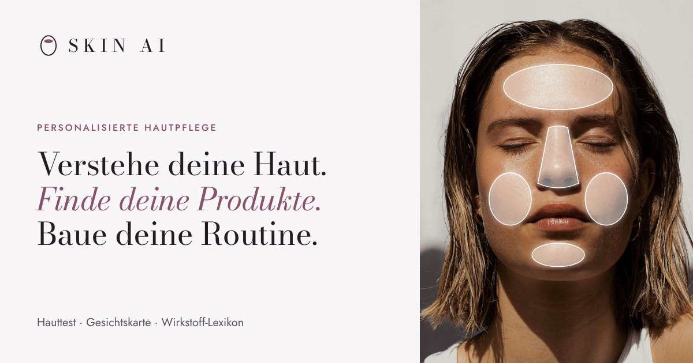
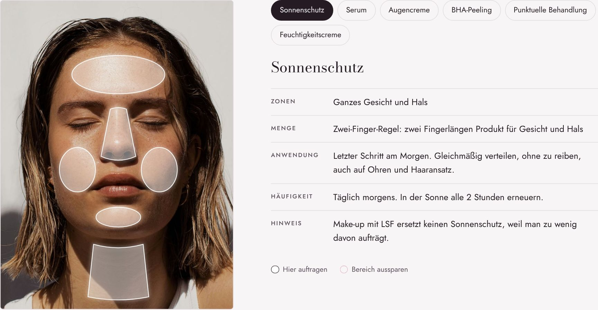
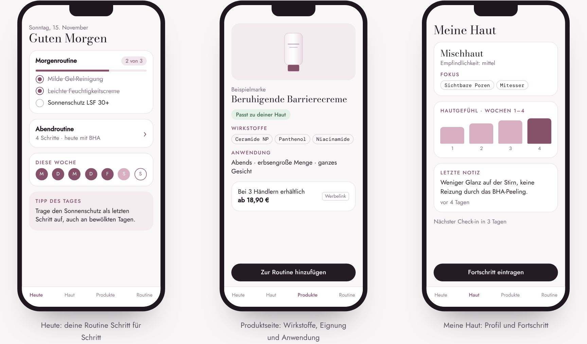
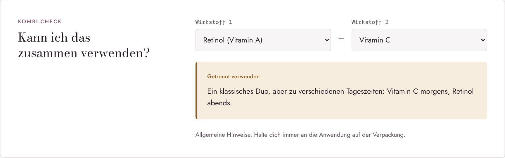

# SKIN AI

**Konzept-Prototyp einer Skincare-App: Hauttest, Gesichtskarte und Wirkstoff-Lexikon, auf Deutsch, Rumänisch und Englisch.**

[Prototyp ansehen →](https://dandelion1111r.github.io/skin-ai/)

## Funktionen

| Bereich | Was er zeigt |
| --- | --- |
| Hauttest | 10 Fragen, inklusive Schwangerschaft und Wetter, danach Hauttyp, Empfindlichkeit, Fokus und eine Routine für morgens und abends |
| Meine Routine | Eigene Produkte auswählen: Reihenfolge für morgens und abends und ein Wochenplan, der Retinol und Peelings auf verschiedene Abende mit Pausen verteilt |
| Hauttagebuch | Routine abhaken, Hautgefühl 1–5 und Notiz, Serie in Folge und Verlauf der letzten 14 Tage, nur im Browser gespeichert |
| Gesichtskarte | Für 6 Produkte: wo, wie viel und wie oft sie aufgetragen werden, inklusive Zonen zum Aussparen |
| Hauttypen und Hautprobleme | 6 Hauttypen und 11 Hautprobleme mit Merkmalen, typischen Zonen und passenden Wirkstoffen |
| Wirkstoff-Lexikon | 10 Wirkstoffe mit INCI-Name, Wirkung, Anwendung und Hinweisen |
| Kombi-Check | Zwei Wirkstoffe wählen und sehen, ob sie zusammenpassen |
| INCI-Check | Inhaltsstoffliste einfügen: Wirkstoffe, Duftstoffe und Alkohol werden erkannt und mit dem Hautprofil abgeglichen, ohne Punkte und ohne Datenübertragung |
| App-Screens | Erste Entwürfe: Heute, Produktseite, Meine Haut |

## Technik

- Eine HTML-Datei mit CSS und JavaScript, ohne Framework und ohne Build-Schritt
- Sprachumschalter Deutsch / Rumänisch / Englisch, Auswahl bleibt im Browser gespeichert
- Installierbar als Web-App (PWA), funktioniert auch offline
- Ergebnis als Bild für Instagram-Stories teilen
- Heller und dunkler Modus, angepasst für Smartphone und Desktop
- Schriften lokal eingebunden, keine Cookies, kein Tracking

Lokal ansehen: `index.html` im Browser öffnen.

## Hinweise

SKIN AI ist ein Konzept-Prototyp und keine echte App. Es werden keine Daten übertragen. Die Inhalte dienen der Information zur kosmetischen Hautpflege und ersetzen keine hautärztliche Beratung.

## Credits

Konzept und Design: Raluca Jidvian, 2026.
Schriftarten: Bodoni Moda, Jost, DM Mono (SIL Open Font License, siehe `fonts/`).
Fotos: Unsplash (Unsplash-Lizenz), unter anderem von Vitaly Gariev, Shutter Speed, Sanket Khatua, Point Normal, Muhammad Sulyman, Crystalweed Cannabis, Andrea Castro, Jocelyn Morales, 360floralflaves.
